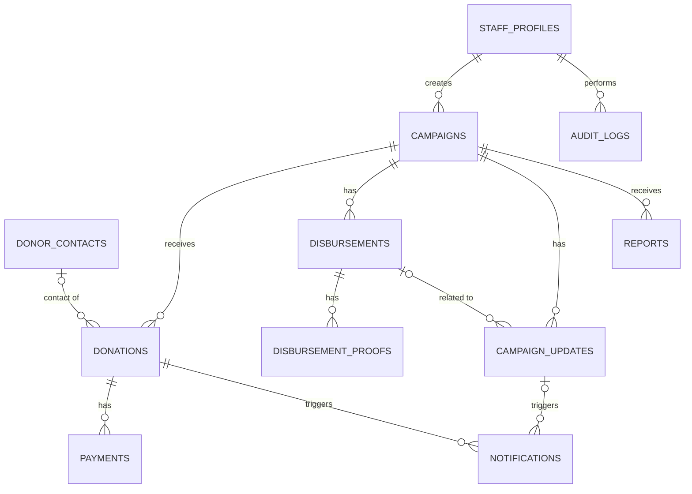

# PRD Lengkap — AyoBantu (Platform Donasi Online, Web App)

|  |  |
| --- | --- |
| **Nama** | AyoBantu |
| **Versi** | 0.5 (draft) — versi lengkap, web app lokal |
| **Tanggal** | 15 Oktober 2026 |
| **Jenis proyek** | Proyek kuliah (belajar merancang dan membangun) |
| **Stack** | Next.js (App Router) + TypeScript, Supabase (PostgreSQL, Auth, Storage) |
| **Referensi model** | Platform donation-based crowdfunding seperti Kitabisa |
| **Dokumen pendamping** | `PRD AyoBantu - Claude Code.md` (ringkas untuk Claude Code) |

> **Konteks:** Aspek legal dan perizinan **diasumsikan sudah terpenuhi** dan tidak menjadi lingkup pengembangan. Aplikasi berbasis web biasa (**bukan PWA**) dan dijalankan **lokal terlebih dahulu**, tanpa integrasi API eksternal.

### Riwayat perubahan

| Versi | Perubahan |
| --- | --- |
| 0.1–0.2 | Draft awal: PWA, QRIS/VA via gateway, Supabase |
| 0.3 | Aspek legal dianggap terpenuhi |
| 0.4 | **Bukan PWA. Pembayaran lokal/manual tanpa gateway. Model data mengikuti ERD MVP. Konfirmasi pembayaran oleh staf.** |
| **0.5** | **Platform diberi nama AyoBantu.** |

---

## 1. Ringkasan

### 1.1 Latar belakang

Donasi online tumbuh pesat, tetapi hambatan utamanya adalah kepercayaan: donatur ingin memastikan uangnya sampai ke tujuan. Platform yang dipercaya adalah yang paling transparan, bukan yang paling banyak fiturnya. Produk ini meniru alur dan tujuan platform seperti Kitabisa: galang dana → donasi → laporan penggunaan dana.

### 1.2 Tujuan produk

1. Memudahkan siapa pun berdonasi dalam waktu singkat **tanpa membuat akun**.
2. Memberi **transparansi**: terkumpul, biaya operasional, dicairkan, sisa, serta bukti pencairan.
3. Memberi Admin dan Finance alat untuk mengelola kampanye, mengonfirmasi pembayaran, mencatat pencairan, dan menangani laporan, dengan jejak audit.
4. Menjadi proyek pembelajaran yang rapi: arsitektur modular, keamanan data, dan pengujian alur inti.

### 1.3 Non-tujuan (di luar lingkup sekarang)

- Payment gateway, QRIS/VA/e-wallet sungguhan, webhook, dan uang sungguhan.
- Email, WhatsApp, atau notifikasi pihak ketiga (hanya dicatat di aplikasi).
- PWA (manifest, service worker, offline, install prompt) dan web push.
- Penggalang dana mandiri dengan akun terpisah, donasi berulang, wallet/saldo tersimpan.
- Zakat dan wakaf, microservices, antrean worker, cron, CAPTCHA, analitik.

### 1.4 Asumsi

- Penyelenggara dianggap sudah memiliki seluruh izin dan kewajiban hukum.
- Tidak ada uang yang berpindah; semua pembayaran adalah catatan lokal.
- Kampanye dibuat dan dikelola oleh tim internal.
- Pengguna utama menggunakan ponsel, sehingga desain mobile-first.

---

## 2. Keputusan produk wajib

| # | Keputusan | Konsekuensi |
| --- | --- | --- |
| D1 | **Lokal dulu** | Jalankan di mesin sendiri. Periksa repo dan stack yang ada sebelum memilih teknologi. Jangan menambah infrastruktur tanpa kebutuhan. |
| D2 | **Tanpa API eksternal** | Tidak ada gateway, email, WhatsApp, atau layanan pihak ketiga. |
| D3 | **Pembayaran lokal/manual** | Donatur mengisi nominal rupiah. Status `paid` **hanya** dari konfirmasi internal staf terotorisasi. Tidak ada tombol publik yang membuat donasi `paid`. |
| D4 | **Mode lokal terlihat jelas** | Env `PAYMENT_MODE=local`; UI staf menampilkan penanda **"MODE LOKAL — tidak ada uang sungguhan"**. |
| D5 | **Bukan PWA** | Web responsif, SSR/ISR untuk halaman publik, Open Graph untuk berbagi. Tanpa manifest/service worker. |
| D6 | **Modul pembayaran siap diperluas** | Aturan inti donasi terpisah dari provider, sehingga gateway dapat ditambah kelak tanpa mengubah aturan inti. Jangan membangun integrasinya sekarang. |
| D7 | **Dana dihitung, bukan diketik** | Angka kampanye selalu dari view/query agregasi, tidak ada kolom total yang bisa diedit. |
| D8 | **Notifikasi dicatat saja** | Tabel `notifications` + tampilan di aplikasi. Tidak ada pengiriman. |

---

## 3. Aktor dan hak akses

| Aktor | Akun | Deskripsi |
| --- | --- | --- |
| **Donatur** | Tidak | Pengunjung yang berdonasi, melacak, dan melaporkan kampanye. |
| **Admin** | Supabase Auth | Mengelola kampanye, update, laporan, dan staf. |
| **Finance** | Supabase Auth | Mengonfirmasi pembayaran, refund, pencairan, bukti, dan ekspor. |
| **Sistem** | n/a | Perhitungan biaya beku, penandaan `expired`, pencatatan notifikasi dan audit. |

### Matriks izin (default usulan, dapat disesuaikan)

| Aksi | Donatur | Admin | Finance |
| --- | --- | --- | --- |
| Lihat kampanye aktif, update, ringkasan dana | ✔ | ✔ | ✔ |
| Buat donasi, lacak via token | ✔ |  |  |
| Kirim laporan kampanye | ✔ |  |  |
| CRUD kampanye, ubah status kampanye |  | ✔ |  |
| Posting update kampanye |  | ✔ |  |
| Tangani laporan kampanye |  | ✔ |  |
| Kelola staf |  | ✔ |  |
| Lihat daftar donasi (tanpa kontak penuh) |  | ✔ | ✔ |
| **Konfirmasi/ubah status pembayaran** |  |  | ✔ |
| **Refund manual** |  |  | ✔ |
| **Catat pencairan, unggah bukti** |  |  | ✔ |
| Ekspor CSV (tanpa kontak) |  | ✔ | ✔ |
| Lihat audit log |  | ✔ | ✔ (baca) |
| Lihat kontak donatur (dekripsi) |  |  | ✔ (terbatas, tercatat di audit) |

Prinsip: tindakan yang menyentuh uang dilakukan Finance; tindakan yang membentuk konten dilakukan Admin.

---

## 4. Alur pengguna

### 4.1 Donasi tanpa akun

1. Donatur membuka `/kampanye` lalu memilih kampanye `active`.
2. Di halaman detail, menekan **Donasi Sekarang**.
3. Mengisi form: nominal (preset atau bebas), nama tampilan (opsional), opsi **Anonim**, pesan (opsional), kontak (email/telepon, opsional, **wajib jika** memilih menerima update), centang `notify_updates`.
4. Server memvalidasi: kampanye aktif dan dalam periode, nominal bilangan bulat ≥ minimum.
5. Server membuat `donor_contacts` (jika ada kontak, terenkripsi), `donations` berstatus `pending`, dan satu catatan `payments` (`gateway=local`, `pending`).
6. Halaman sukses menampilkan ringkasan donasi, status **Menunggu konfirmasi**, dan **tautan lacak** `/lacak/{token}` yang **hanya tampil sekali** (simpan/salin). Hanya hash token yang disimpan.
7. Finance mengonfirmasi pembayaran di dashboard → donasi `paid`, biaya operasional dibekukan, notifikasi `receipt` dicatat.
8. Donatur membuka tautan lacak untuk melihat status dan bukti donasi.

> Karena tidak ada email, token yang hilang tidak dapat dipulihkan (hanya hash tersimpan). Peringatan ini harus tampil di halaman sukses.

### 4.2 Melacak donasi

`/lacak/{token}` menampilkan: kampanye, nominal, status, waktu, nama tampilan, kontak tersamar (mis. `ab***@gmail.com`), dan notifikasi yang tercatat. Halaman `noindex`, tidak di-cache, dengan pembatasan laju akses.

### 4.3 Melihat transparansi

Halaman kampanye menampilkan **Terkumpul, Operasional, Dicairkan, Sisa**, penanda **Belum dilaporkan**, daftar donatur, update, serta riwayat pencairan (kategori, nominal, tanggal, status, penerima, dan bukti publik bila tersedia).

### 4.4 Admin membuat dan mengelola kampanye

`draft` → isi data (judul, cerita, target, periode, penerima manfaat, gambar, fee) → pratinjau → `active`. Dapat `closed` (selesai) atau `suspended` (ditangguhkan, mis. karena laporan).

### 4.5 Konfirmasi pembayaran (Finance)

1. Buka `/admin/donations`, filter `pending`.
2. Periksa donasi (nominal, waktu, kampanye) sesuai prosedur internal.
3. Pilih **Konfirmasi (paid)**, **Gagal (failed)**, atau biarkan hingga `expired`.
4. Sistem dalam satu transaksi: ubah status donasi dan payment, isi `paid_at`, hitung `operational_fee_amount`, catat notifikasi, catat `audit_logs`.

### 4.6 Pencairan dana (Finance)

1. Buat pencairan `planned` (kampanye, nominal ≤ sisa, kategori, deskripsi, penerima).
2. Setelah dana dikirim secara manual, ubah ke `disbursed` (isi `disbursed_at`).
3. Unggah bukti (`nota`, `transfer`, `foto`).
4. Ubah ke `reported` hanya jika bukti wajib tersedia.
5. Admin dapat menerbitkan update kampanye yang terkait pencairan.

### 4.7 Refund manual (Finance)

Isi nominal refund (≤ nominal donasi) dan alasan. Sistem memperbarui `refund_amount`, `refunded_at`, `refund_note`, mengubah status menjadi `refunded` bila refund penuh, dan mencatat audit. Refund ditolak jika membuat **Sisa** kampanye negatif.

### 4.8 Laporan kampanye

Pengunjung menekan **Laporkan kampanye** (alasan + detail + kontak opsional). Admin meninjau: `open → reviewed → closed`, dan dapat menangguhkan kampanye.

---

## 5. Kebutuhan fungsional

Prioritas: **P0** wajib, **P1** target jika waktu cukup.

### 5.1 Publik

| ID | Kebutuhan | P |
| --- | --- | --- |
| F-01 | Beranda dan daftar kampanye aktif (pencarian sederhana, progres terhadap target) | P0 |
| F-02 | Detail kampanye: cerita, gambar, ringkasan dana, update, daftar donatur, riwayat pencairan | P0 |
| F-03 | Form donasi tanpa akun, nominal rupiah, opsi anonim, pesan | P0 |
| F-04 | Halaman sukses dengan tautan lacak sekali tampil | P0 |
| F-05 | Halaman lacak `/lacak/{token}` (noindex, rate limit) | P0 |
| F-06 | Laporkan kampanye | P0 |
| F-07 | Open Graph + tombol bagikan (Web Share API bila tersedia, fallback salin tautan) | P0 |
| F-08 | Halaman `/transparansi` (ringkasan agregat seluruh platform) | P1 |

### 5.2 Admin

| ID | Kebutuhan | P |
| --- | --- | --- |
| A-01 | Login staf (Supabase Auth) + guard role | P0 |
| A-02 | CRUD kampanye dan perubahan status | P0 |
| A-03 | Upload gambar kampanye (bucket publik) | P0 |
| A-04 | Posting update kampanye (opsional terkait pencairan) | P0 |
| A-05 | Penanganan laporan kampanye | P0 |
| A-06 | Kelola staf (aktif/nonaktif, role) | P0 |
| A-07 | Lihat audit log | P1 |

### 5.3 Finance

| ID | Kebutuhan | P |
| --- | --- | --- |
| FN-01 | Daftar donasi dengan filter (status, kampanye, tanggal) | P0 |
| FN-02 | Konfirmasi/ubah status pembayaran lokal + audit | P0 |
| FN-03 | Refund manual + audit | P0 |
| FN-04 | CRUD pencairan, ubah status, unggah bukti (bucket privat) | P0 |
| FN-05 | Ekspor CSV donasi tanpa kontak secara default | P0 |
| FN-06 | Ringkasan dana per kampanye (view `campaign_funds`) | P0 |

### 5.4 Sistem

| ID | Kebutuhan | P |
| --- | --- | --- |
| S-01 | Perhitungan dan pembekuan `operational_fee_amount` saat `paid` | P0 |
| S-02 | Penandaan `expired` untuk `pending` melewati batas waktu (dievaluasi saat akses/aksi staf, tanpa cron) | P0 |
| S-03 | Pencatatan notifikasi `receipt` dan `update` di tabel `notifications` | P0 |
| S-04 | Pencatatan `audit_logs` untuk semua aksi uang dan status kampanye | P0 |
| S-05 | Enkripsi/dekripsi kontak (AES-256-GCM) | P0 |

---

## 6. Aturan bisnis

### 6.1 Diagram status

- **Kampanye:** `draft → active → closed`; `active ↔ suspended`; `closed` bersifat final.
- **Donasi:** `pending → paid | failed | expired`; `paid → refunded` (refund penuh).
- **Payment (lokal):** mengikuti donasi: `pending | paid | failed | expired`.
- **Pencairan:** `planned → disbursed → reported`.
- **Laporan:** `open → reviewed → closed`.

### 6.2 Donasi

1. Hanya kampanye `active` dan dalam periode (`starts_at ≤ sekarang ≤ ends_at`, bila diisi) yang menerima donasi.
2. Nominal: bilangan bulat positif ≥ nominal minimum (konfigurasi).
3. Status `paid` hanya dari aksi konfirmasi staf. Konfirmasi ulang bersifat **idempotent** (tidak mengubah fee atau saldo).
4. `operational_fee_amount = floor(amount × operational_fee_bps / 10000)` dihitung dan **dibekukan** saat `paid`. Mengubah `operational_fee_bps` kampanye kemudian tidak mengubah donasi lama.
5. `pending` yang melewati masa berlaku ditandai `expired`. Donasi `expired` atau `failed` tidak dihitung sebagai dana.

### 6.3 Rumus dana kampanye (view `campaign_funds`)

| Angka | Rumus |
| --- | --- |
| **Terkumpul** | Σ (`amount` − `refund_amount`) pada donasi berstatus `paid` atau `refunded` |
| **Operasional** | Σ `operational_fee_amount` pada donasi berstatus `paid` |
| **Dicairkan** | Σ `disbursements.amount` berstatus `disbursed` atau `reported` |
| **Sisa** | Terkumpul − Operasional − Dicairkan |
| **Belum dilaporkan** | Σ pencairan berstatus `disbursed` (belum `reported`) |

Aturan turunan:

- Pencairan tidak boleh membuat **Sisa** negatif (dicek di server dalam transaksi).
- Refund tidak boleh membuat **Sisa** negatif.
- Refund penuh membatalkan biaya operasional donasi tersebut (karena status menjadi `refunded`). Refund sebagian tidak mengubah fee yang sudah dibekukan *(default usulan, lihat Bagian 17)*.

### 6.4 Pencairan

- `reported` hanya boleh setelah bukti wajib tersedia (default: minimal 1 bukti `transfer`).
- Pencairan **tidak dihapus**. Koreksi lewat perubahan status atau catatan yang diaudit.

### 6.5 Anonimitas dan privasi

- Publik hanya melihat `display_name`; jika `is_anonymous`, tampil "Anonim". Donasi tanpa nama tampil "Orang Baik".
- Kontak disimpan terpisah (`donor_contacts`) dan terenkripsi.
- Ekspor CSV tidak menyertakan kontak secara default.
- Tersedia mekanisme penghapusan kontak atas permintaan; retensi kontak mengikuti konfigurasi.

---

## 7. Fitur inti: transparansi

Halaman kampanye menampilkan blok **Ringkasan Dana**:

| Blok | Isi |
| --- | --- |
| Empat angka | Terkumpul, Operasional (dengan persentase), Dicairkan, Sisa |
| Penanda | "Dana belum dilaporkan: Rp X" bila ada pencairan `disbursed` tanpa `reported` |
| Riwayat pencairan | Tanggal, kategori, nominal, penerima, status, dan tautan bukti publik bila tersedia |
| Update kampanye | Timeline, dengan keterkaitan ke pencairan |
| Daftar donatur | Nama tampilan/Anonim, nominal, pesan, waktu |

**Bukti publik (usulan di luar ERD contoh):** tambahkan kolom `is_public boolean default false` pada `disbursement_proofs`. Hanya bukti bertanda publik yang ditampilkan ke pengunjung (lewat signed URL berumur pendek yang dibuat server), dan sebelum ditandai publik staf harus memastikan tidak ada data sensitif. Bila tidak ingin menambah kolom, tampilkan hanya jumlah bukti yang tersedia.

Platform-level (P1): `/transparansi` menampilkan total donasi, total operasional, total dicairkan, dan jumlah kampanye.

---

## 8. Arsitektur

### 8.1 Gaya arsitektur

Satu aplikasi **monolit modular** dalam satu repositori. Tidak ada microservices.

```
Browser ──► Next.js (halaman SSR/ISR + Route Handlers + Server Actions)
              │
              ├── modul domain (service/repo/schema)
              │
              └──► Supabase: PostgreSQL (+RLS), Auth (staf), Storage (gambar & bukti)
```

### 8.2 Modul

`campaigns` · `donations` · `payments` · `disbursements` · `campaign-updates` · `notifications` · `reports` · `audit-logs` · `staff/auth`

### 8.3 Struktur folder (usulan)

```
src/
  app/
    (public)/kampanye/ , kampanye/[slug]/ , lacak/[token]/ , transparansi/
    (staff)/admin/ campaigns, donations, disbursements, updates, reports, staff, audit
    api/ donations, reports
  modules/<modul>/ { schema.ts, service.ts, repo.ts, types.ts }
  lib/ { supabase/, crypto.ts, money.ts, token.ts, rate-limit.ts, auth.ts }
supabase/
  migrations/ , seed.sql
tests/ { unit, integration, e2e }
```

### 8.4 Modul pembayaran (siap diperluas)

`payments` mengekspos antarmuka `PaymentProvider` dengan satu implementasi `LocalProvider`:

- `createPayment(donation)` → catatan `payments` lokal berstatus `pending`.
- `confirm(paymentId, actor)` → dipanggil oleh aksi staf; menjalankan transaksi `paid`. Gateway di masa depan cukup menambah implementasi baru tanpa mengubah aturan inti (fee, ledger, audit).

### 8.5 Supabase lokal

Gunakan Supabase CLI (`supabase start`, butuh Docker) agar Postgres, Auth, dan Storage berjalan di mesin sendiri tanpa layanan cloud. Migrasi lewat `supabase/migrations`, data contoh lewat `supabase/seed.sql`.

### 8.6 Konvensi

- TypeScript strict; validasi input dengan Zod di setiap Route Handler/Server Action.
- Util `money.ts`: simpan integer rupiah, format `id-ID` (mis. `Rp25.000`).
- Waktu disimpan UTC, ditampilkan Asia/Jakarta.
- Jangan menambah library atau infrastruktur hanya untuk antisipasi kebutuhan masa depan.

---

## 9. Model data

### 9.1 Aturan umum

- PK `id` bertipe UUID. Uang `BIGINT` rupiah (bukan desimal). `created_at` di semua tabel.
- Foreign key, constraint, dan indeks diterapkan penuh. CHECK untuk nilai uang > 0 dan status valid.
- Migrasi dapat dilacak di repositori (tidak mengandalkan perubahan manual di dashboard).

### 9.2 ERD



### 9.3 Definisi tabel

**`staff_profiles`** — id (= `auth.users.id`), nama, role \[`admin`|`finance`\], is_active, created_at.

**`campaigns`** — id, slug (unik), title, story, cover_image_url, target_amount, status \[`draft`|`active`|`closed`|`suspended`\], starts_at, ends_at, operational_fee_bps (500 = 5%, CHECK 0–1000), beneficiary_name, created_by → staff_profiles, created_at.

**`donor_contacts`** — id, email_enc, phone_enc (AES-256-GCM, opsional), created_at.

**`donations`** — id, campaign_id → campaigns, donor_contact_id → donor_contacts (nullable), amount, operational_fee_amount (default 0, dibekukan saat paid), status \[`pending`|`paid`|`failed`|`expired`|`refunded`\], display_name, is_anonymous, message, notify_updates, tracking_token_hash (unik), refund_amount (default 0, CHECK ≤ amount), refunded_at, refund_note, paid_at, created_at.

**`payments`** — id, donation_id → donations, gateway (= `local`), gateway_order_id (unik, ID internal), method (label: `transfer`|`qris`, opsional), gross_amount, status \[`pending`|`paid`|`failed`|`expired`\], pay_url (null), expires_at, paid_at, created_at.

**`disbursements`** — id, campaign_id → campaigns, amount, category, description, recipient_name, disbursed_at, status \[`planned`|`disbursed`|`reported`\], created_by → staff_profiles, created_at.

**`disbursement_proofs`** — id, disbursement_id → disbursements, file_url (path di bucket privat), kind \[`nota`|`transfer`|`foto`\], is_public (usulan, default false), uploaded_by → staff_profiles, uploaded_at, created_at.

**`campaign_updates`** — id, campaign_id → campaigns, disbursement_id → disbursements (nullable), title, body, image_urls (array), posted_by → staff_profiles, posted_at, created_at.

**`notifications`** — id, donation_id → donations, campaign_update_id → campaign_updates (nullable), type \[`receipt`|`update`\], channel \[`email`|`whatsapp`\], status \[`queued`|`sent`|`failed`\], attempts, error, sent_at, created_at. *(Pada MVP semua berstatus `queued`; tidak ada pengiriman.)*

**`reports`** — id, campaign_id → campaigns, reason, details, reporter_contact (nullable), status \[`open`|`reviewed`|`closed`\], handled_by → staff_profiles (nullable), created_at.

**`audit_logs`** — id, user_id → staff_profiles, action, entity_type, entity_id, changes (jsonb), created_at. **Tidak boleh diubah atau dihapus** (cabut UPDATE/DELETE + trigger penolak).

*(Tabel `payment_events` dilewati karena tidak ada webhook; dapat ditambah saat gateway diintegrasikan.)*

### 9.4 View dan fungsi

- `campaign_funds` — agregasi Bagian 6.3 per kampanye.
- `public_campaigns` — kampanye `active` + angka dana aman.
- `public_donors` — `display_name` (atau "Anonim"), nominal, pesan, `paid_at`; tanpa kontak.
- `public_disbursements` — kategori, nominal, tanggal, status, penerima; tanpa rekening.
- `public_updates` — update terbit.
- Fungsi `confirm_donation(donation_id, actor)` — atomik dan idempotent: set `paid`, isi `paid_at`, hitung dan bekukan fee, update payment, catat notifikasi dan audit.
- Fungsi `refund_donation(donation_id, amount, note, actor)` dan `disburse(...)` yang memeriksa **Sisa ≥ 0** dalam transaksi.

---

## 10. Keamanan dan RLS

1. **RLS aktif** di semua tabel `public`. Tanpa policy berarti tertutup.
2. `anon` hanya membaca lewat **view publik**. Tabel sensitif (`donations`, `donor_contacts`, `payments`, `notifications`, `reports`, `audit_logs`) tidak punya policy untuk `anon`.
3. **`service_role` hanya di server**, tidak pernah ke browser atau variabel `NEXT_PUBLIC_*`.
4. Donasi publik dibuat lewat `POST /api/donations` di server (validasi Zod, rate limit); tidak ada INSERT langsung dari klien.
5. Peran staf dibaca dari `staff_profiles`/`app_metadata`, bukan `user_metadata`. Helper `is_staff(role)` bersifat `SECURITY DEFINER`.
6. **Token lacak:** acak ≥ 32 byte (CSPRNG), hanya **hash** (SHA-256) tersimpan, perbandingan constant-time, halaman `noindex`, rate limit sederhana (in-memory cukup untuk lokal).
7. **Enkripsi kontak:** AES-256-GCM, kunci dari env `CONTACT_ENC_KEY`, tidak disimpan di database.
8. **Storage:** `campaign-images` publik; `disbursement-proofs` privat, unggah hanya staf, akses lewat signed URL singkat.
9. Ekspor CSV tidak menyertakan kontak; dekripsi kontak hanya oleh Finance dan dicatat di audit.
10. Secret hanya di `.env.local`; sediakan `.env.example`; jangan commit secret.
11. MFA staf (TOTP) bersifat opsional untuk MVP lokal; aktifkan bila konfigurasi mendukung.
12. Escape output untuk mencegah XSS (cerita kampanye dan pesan donatur adalah input pengguna).

---

## 11. Endpoint

Nama dapat menyesuaikan framework; fungsi dipertahankan.

| Akses | Endpoint | Fungsi |
| --- | --- | --- |
| Publik | `GET /kampanye` | Daftar kampanye aktif |
| Publik | `GET /kampanye/{slug}` | Detail kampanye, dana, update, donatur, pencairan |
| Publik | `POST /api/donations` | Validasi, buat contact + donasi `pending` + payment lokal, kembalikan token lacak (sekali) |
| Publik | `GET /lacak/{token}` | Status donasi privat |
| Publik | `POST /api/reports` | Kirim laporan kampanye |
| Admin | `POST /admin/campaigns` · `PATCH /admin/campaigns/{id}` | Buat/ubah kampanye dan status |
| Admin | `POST /admin/campaign-updates` | Posting update + catat notifikasi |
| Admin | `PATCH /admin/reports/{id}` | Tangani laporan |
| Finance | `GET /admin/donations` | Daftar donasi |
| Finance | `PATCH /admin/donations/{id}/payment-status` | Konfirmasi/ubah status pembayaran lokal (audit) |
| Finance | `POST /admin/donations/{id}/refund` | Refund manual (audit) |
| Finance | `POST /admin/disbursements` · `PATCH /admin/disbursements/{id}` | Catat dan ubah status pencairan |
| Finance | `POST /admin/disbursements/{id}/proofs` | Unggah bukti |
| Finance/Admin | `GET /admin/donations.csv` | Ekspor tanpa kontak |

**Tidak ada** `POST /api/webhooks/payment` pada MVP.

---

## 12. Halaman dan UI

### 12.1 Publik

| Rute | Isi |
| --- | --- |
| `/` | Hero singkat, kampanye unggulan, cara kerja, ringkasan transparansi |
| `/kampanye` | Daftar kartu kampanye (gambar, judul, progres, sisa waktu) |
| `/kampanye/[slug]` | Tab/blok: Cerita, Ringkasan Dana, Update, Donatur, Pencairan; tombol Donasi dan Laporkan |
| `/kampanye/[slug]/donasi` | Form donasi |
| `/donasi/sukses` | Ringkasan + tautan lacak sekali tampil + peringatan simpan token |
| `/lacak/[token]` | Status donasi privat |
| `/transparansi` (P1) | Ringkasan agregat platform |

### 12.2 Staf

`/admin/login` · `/admin` (ringkasan) · `/admin/campaigns` (+ form) · `/admin/donations` · `/admin/disbursements` · `/admin/updates` · `/admin/reports` · `/admin/staff` · `/admin/audit`

### 12.3 Prinsip UI

- Mobile-first (lebar ≥ 360 px), bahasa Indonesia, format rupiah `id-ID`.
- Form donasi: nominal preset (mis. 10rb, 25rb, 50rb, 100rb) + nominal bebas, pesan galat jelas.
- Penanda **MODE LOKAL** selalu terlihat di area staf.
- Aksesibilitas dasar: label form, fokus terlihat, kontras memadai.

---

## 13. Kebutuhan non-fungsional

| Area | Kebutuhan |
| --- | --- |
| Kinerja | Halaman publik ringan (ISR); LCP \< 2,5 dtk pada lingkungan lokal tipikal |
| Integritas data | Transaksi atomik untuk konfirmasi/refund/pencairan; constraint DB sebagai pagar terakhir |
| Keamanan | Bagian 10 |
| Ketelusuran | Semua aksi uang dan status kampanye masuk `audit_logs` |
| Keterbacaan kode | Modular, Zod di batas input, tanpa abstraksi berlebihan |
| Reproduksibilitas | `supabase start` + migrasi + seed = lingkungan siap pakai; `README` langkah menjalankan |
| Lokalisasi | Bahasa Indonesia; UTC di DB, Asia/Jakarta di UI |
| Log | Log terstruktur sederhana ke konsol |

---

## 14. Rencana kerja bertahap

| Tahap | Cakupan | Kriteria selesai |
| --- | --- | --- |
| **1. Lokal berjalan** | Init project, env example, `PAYMENT_MODE=local`, lint/build | `npm run build` lulus; README menjelaskan cara menjalankan |
| **2. Database & auth** | Migrasi, RLS, view publik, fungsi, trigger audit append-only, login staf + guard role, seed | Tes RLS: `anon` ditolak ke tabel sensitif; login Admin/Finance berfungsi |
| **3. Kampanye** | CRUD admin, upload gambar, daftar/detail publik, Open Graph | Kampanye `draft` tidak tampil publik; `active` tampil |
| **4. Donasi & pembayaran lokal** | Form, `POST /api/donations`, token lacak, halaman sukses/lacak, konfirmasi Finance, catat notifikasi | e2e: donasi → `pending` → konfirmasi → `paid` dan angka dana berubah |
| **5. Dashboard & pencairan** | Daftar donasi, refund, pencairan + bukti, update, laporan, ekspor CSV | `reported` ditolak tanpa bukti; Sisa tidak pernah negatif |
| **6. Pengujian & polish** | Lengkapi test, perbaiki UX, siapkan data demo | Semua test hijau; skenario demo berjalan mulus |

---

## 15. Strategi pengujian

| Jenis | Cakupan |
| --- | --- |
| Unit | Validasi nominal, `money.ts`, perhitungan fee (pembulatan), hash/verify token, enkripsi kontak |
| Integrasi (terhadap Supabase lokal) | Konfirmasi idempotent; fee beku saat fee kampanye diubah; refund penuh/sebagian; rumus dana; Sisa tak negatif; `reported` tanpa bukti ditolak; audit log tercatat |
| Keamanan | RLS: `anon` ditolak ke tabel sensitif; Admin/Finance sesuai matriks; `audit_logs` tidak bisa diubah/dihapus; anonimitas (kontak tak pernah muncul di view publik) |
| e2e (Playwright) | Donasi tamu → tautan lacak → konfirmasi Finance → status/angka berubah; pencairan + bukti → tampil di halaman kampanye |

---

## 16. Kriteria keberhasilan (proyek kuliah)

- Alur inti berjalan end-to-end secara lokal tanpa layanan eksternal.
- Angka dana selalu konsisten dengan data sumber, dibuktikan oleh test.
- Aturan "tidak ada `paid` tanpa konfirmasi staf" dan "tidak ada pencairan melebihi sisa" ditegakkan di database.
- Data pribadi donatur tidak pernah terbuka ke publik.
- Dapat didemokan dalam ≤ 10 menit dengan skenario berikut.

### Skenario demo

1. Buka beranda dan salah satu kampanye aktif; tunjukkan Ringkasan Dana.
2. Berdonasi sebagai tamu (anonim); simpan tautan lacak.
3. Buka tautan lacak: status **Menunggu konfirmasi**.
4. Login Finance: konfirmasi pembayaran → status `paid`.
5. Muat ulang: angka Terkumpul/Operasional/Sisa berubah; tautan lacak menampilkan `paid`.
6. Finance mencatat pencairan, menandai `disbursed`, unggah bukti.
7. Admin memposting update terkait pencairan.
8. Halaman kampanye menampilkan riwayat pencairan; tunjukkan penanda "belum dilaporkan" berubah setelah `reported`.
9. Kirim laporan kampanye; Admin menangani dan menangguhkan kampanye.
10. Tunjukkan audit log.

### Data seed

3 kampanye (aktif, draft, closed), ±10 donasi berbagai status, 2 pencairan (satu `reported`), 2 update, 1 laporan, akun staf lokal untuk Admin dan Finance (hanya untuk development).

---

## 17. Konfigurasi dan pertanyaan terbuka

### Konfigurasi (default usulan, ubah bila perlu)

| Parameter | Default |
| --- | --- |
| Nominal minimum donasi | Rp10.000 |
| `operational_fee_bps` default | 500 (5%) |
| Masa berlaku `pending` | 24 jam |
| Retensi kontak donatur | 12 bulan |
| Bukti wajib untuk `reported` | Minimal 1 bukti `transfer` |
| Rate limit lacak/donasi | Contoh: 10 permintaan/menit/IP |

### Pertanyaan terbuka

1. Apakah izin rinci Admin vs Finance (Bagian 3) sudah sesuai kebutuhan?
2. Refund sebagian: fee tetap, atau dikembalikan proporsional?
3. Apakah perlu kolom `is_public` pada bukti pencairan agar bukti tampil ke donatur?
4. Apakah donatur boleh mendonasikan tanpa kontak sama sekali (token jadi satu-satunya jalan lacak)?
5. Apakah daftar donatur publik menampilkan nominal, atau hanya nama dan pesan?
6. Kategori kampanye perlu ditambahkan (medis, bencana, pendidikan) sebagai kolom/filter?
7. Apakah perlu halaman donasi tertanam (embed) untuk mitra? (default: tidak)

---

## 18. Risiko dan mitigasi

| Risiko | Dampak | Mitigasi |
| --- | --- | --- |
| Status `paid` terubah tanpa otorisasi | Data uang salah | Hanya fungsi server `confirm_donation`; RLS menutup tabel; test akses |
| Angka dana tidak konsisten | Kepercayaan hilang | Angka hanya dari view; test rumus; constraint DB |
| Kebocoran kontak donatur | Privasi | Enkripsi, view publik tanpa kontak, `service_role` hanya server |
| Konfigurasi RLS salah | Data terbuka | RLS di semua tabel; tes otomatis `anon` |
| Token lacak hilang | Donatur tak bisa melacak | Peringatan jelas di halaman sukses; opsi simpan/salin |
| Scope creep | Proyek tak selesai | Batasan MVP (Bagian 1.3); tahap berurutan; larangan fitur tambahan |
| Salah paham "mode lokal" saat demo | Dianggap uang nyata | Penanda MODE LOKAL di UI |

---

## 19. Peta jalan (setelah MVP)

1. **Pembayaran sungguhan:** adaptor payment gateway (QRIS dinamis, Virtual Account), webhook terverifikasi dan idempotent, rekonsiliasi, tabel `payment_events`.
2. **Notifikasi:** pengiriman email/WhatsApp dari antrean `notifications`.
3. **PWA:** manifest, service worker (network-first untuk halaman kampanye), prompt install.
4. **Penggalang dana mandiri** dengan verifikasi, **maker-checker** untuk pencairan, dan MFA staf wajib.
5. **Anti-spam & operasional:** CAPTCHA, pemantauan error, analitik, backup terjadwal.

---

## Lampiran A — Glosarium

| Istilah | Arti |
| --- | --- |
| Kampanye | Penggalangan dana dengan target, periode, dan penerima manfaat |
| Donasi `pending` | Sudah dicatat, belum dikonfirmasi staf |
| Biaya operasional | Persentase donasi (bps) untuk menutup biaya platform; dibekukan saat `paid` |
| Pencairan | Penyaluran dana kampanye kepada penerima manfaat |
| Bukti pencairan | Nota/transfer/foto yang mendukung pencairan |
| bps | Basis poin; 100 bps = 1% |
| MODE LOKAL | Mode tanpa gateway; pembayaran hanya catatan |

## Lampiran B — Kriteria penerimaan contoh

**Donasi tamu**

- Diberikan kampanye `active`, ketika nominal ≥ minimum dan data valid dikirim, maka terbentuk donasi `pending` + payment `local` + token lacak yang tampil sekali.
- Nominal \< minimum, kampanye non-aktif, atau di luar periode ditolak dengan pesan jelas.

**Konfirmasi pembayaran**

- Hanya Finance yang dapat mengubah status ke `paid`; Admin dan anon ditolak.
- Konfirmasi dua kali tidak menggandakan Terkumpul atau fee.
- Fee donasi lama tidak berubah setelah `operational_fee_bps` kampanye diubah.

**Pencairan**

- Pencairan dengan nominal > Sisa ditolak.
- `reported` tanpa bukti wajib ditolak.
- Setiap perubahan status pencairan tercatat di `audit_logs`.

**Privasi**

- View/endpoint publik tidak pernah memuat email atau telepon.
- Donasi anonim tampil sebagai "Anonim" di daftar donatur.
- Ekspor CSV default tidak berisi kontak.